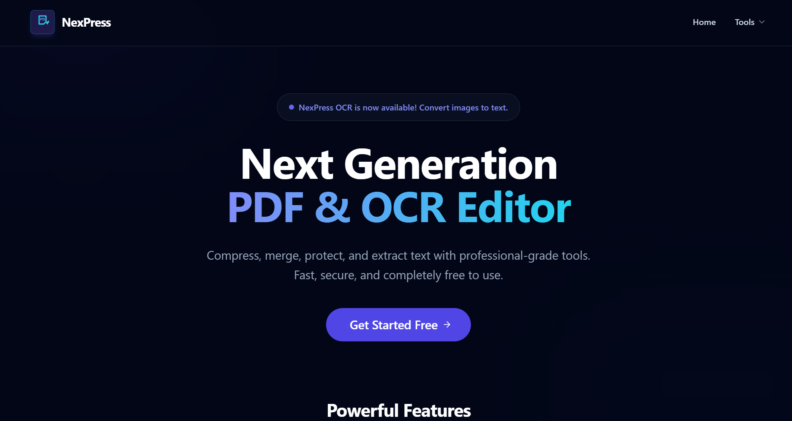
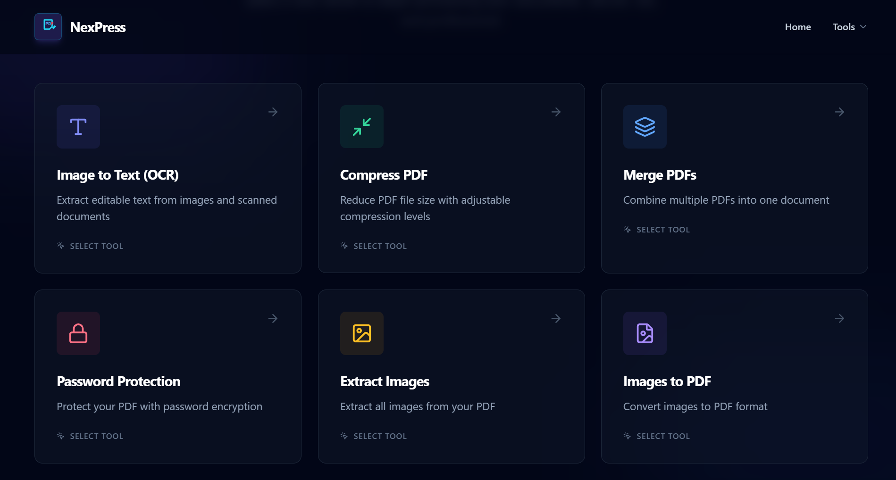
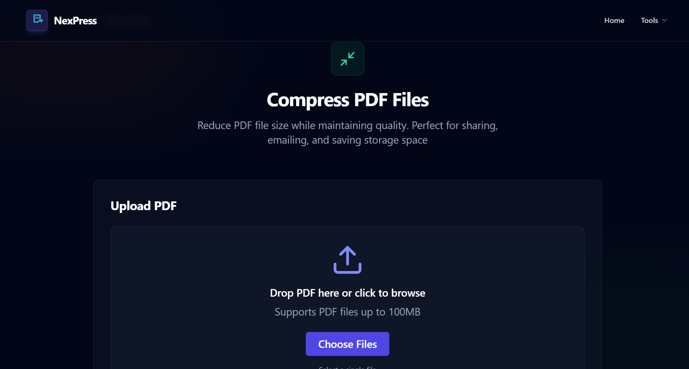
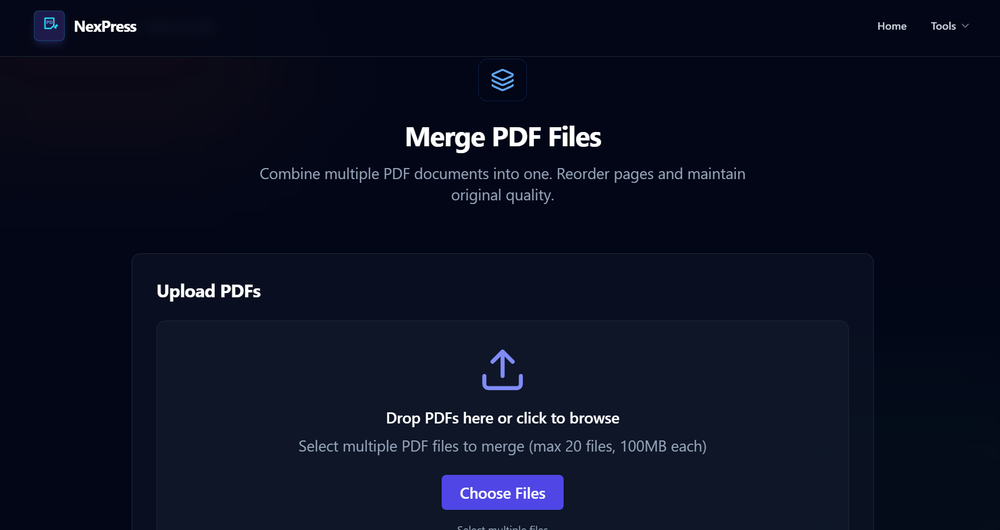
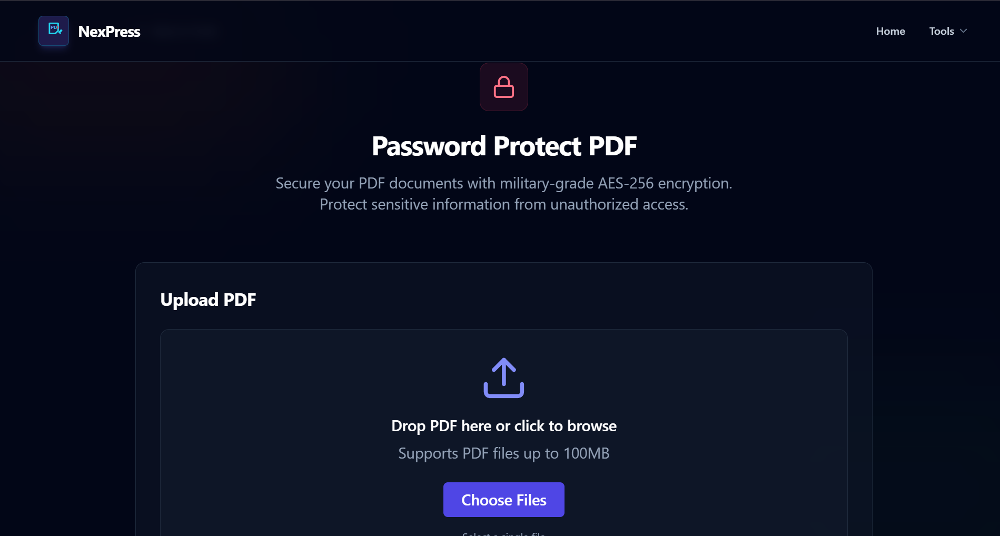
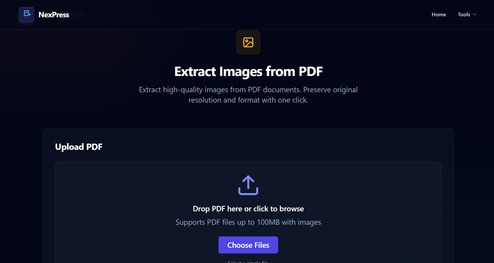
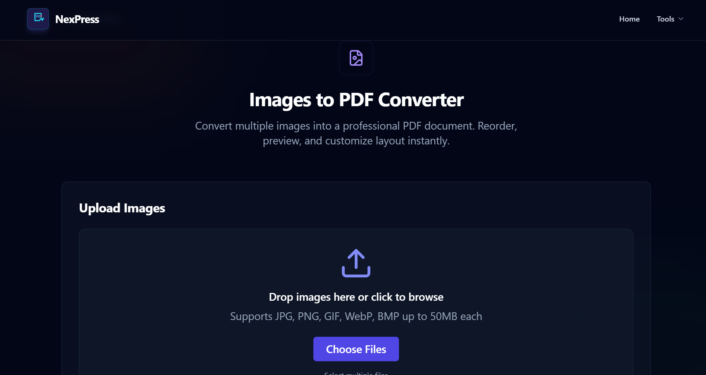
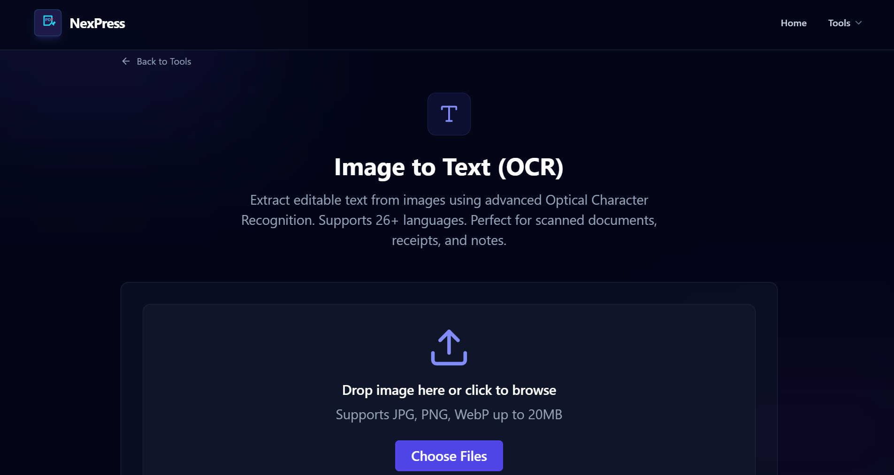

# NexPress — Next Generation PDF & OCR Editor

<p align="center">
  
</p>

<p align="center">
  <strong>Eleven PDF and OCR tools that run entirely inside your browser.</strong><br />
  No backend, no uploads, no accounts — <em>your files never leave your device.</em>
</p>

<p align="center">
  
  
  
  
  
  
  
  
</p>

<p align="center">
  <a href="https://nexpresshrx.netlify.app/" target="_blank" rel="noopener noreferrer">
    
  </a>
</p>

---

## 📖 About

**NexPress** is a browser-based PDF powerhouse with **eleven tools**, all running locally on your machine. Compress a bulky scan, merge or split documents, reorganise pages visually, encrypt with AES-256, stamp a watermark, add page numbers, drop in a drawn signature, pull images in or out of a PDF, and run OCR — with no uploads, no servers and no privacy trade-offs.

Built with **React 19**, **Vite 7** and **Tailwind CSS 3**, NexPress ships a responsive interface with a **light and dark theme**, route-level code splitting so each tool only loads the libraries it needs, and a **service worker** that makes the installed app work offline.

---

## ✨ Tools

| Tool                            | Route             | What it does                                                                                                                                                                                                         |
| ------------------------------- | ----------------- | -------------------------------------------------------------------------------------------------------------------------------------------------------------------------------------------------------------------- |
| 🔽 **Compress PDF**             | `/compress`       | Four levels (Low / Medium / High / Aggressive). Low rewrites the file structure and keeps text selectable; the other levels re-encode pages as JPEG. Both candidates are built and **the smaller file always wins**. |
| 🔗 **Merge PDF**                | `/merge`          | Combine up to 20 PDFs, reorder them by drag-and-drop, and keep original page content intact.                                                                                                                         |
| 🧩 **Organize Pages**           | `/organize`       | Thumbnail grid of every page: reorder, rotate in 90° steps and delete pages, then export the pages you kept.                                                                                                         |
| ✂️ **Split PDF**                | `/split`          | Page ranges like `1-3, 5, 8-` become separate PDFs, downloaded together as a ZIP.                                                                                                                                    |
| 🔒 **Password Protect**         | `/protect`        | Encrypt with a user + owner password using **AES-256 (revision 6)**, and remove a password from a PDF when you know it.                                                                                              |
| 🏷️ **Watermark & Page Numbers** | `/watermark`      | Stamp text diagonally across every page (or just the first) with adjustable size, opacity and colour, and add `1 / 12`-style page numbers with a custom format, start number, margin and position.                   |
| ✍️ **Sign PDF**                 | `/sign`           | Draw a signature with mouse, pen or touch; transparent padding is trimmed and it is stamped at the bottom of the first page, the last page or every page, with left/centre/right placement and an adjustable size.   |
| 🖼️ **Extract Images**           | `/extract-images` | Pull the embedded raster images out of a PDF as PNGs — individually or as a ZIP. Pages containing only text or vectors get a rendered page image instead, so every page returns something useful.                    |
| 📄 **Images to PDF**            | `/images-to-pdf`  | Turn JPG, PNG, GIF, WebP or BMP images into one PDF. A4 portrait/landscape (aspect ratio preserved, centred) or pages sized exactly to each image.                                                                   |
| 📸 **PDF to Images**            | `/pdf-to-images`  | Render every page to JPG or PNG at 1×, 2× or 3× resolution with adjustable JPEG quality, then download pages one by one or as a ZIP.                                                                                 |
| 📝 **Image to Text (OCR)**      | `/image-to-text`  | Recognise text in images with Tesseract.js in **12 languages**, show the confidence score and copy the result with one click.                                                                                        |

---

## 🎯 Highlights

- 🔐 **100% client-side** — no backend, no database, no file uploads. PDF work happens in the tab with pdf-lib and pdf.js.
- 🌗 **Light + dark theme** — toggle in the navbar, choice saved to `localStorage`, animated cross-fade, and an inline script that applies the theme before first paint so there is no flash of the wrong colours.
- 📴 **Installable & offline** — web app manifest plus a service worker that caches the app shell and hashed assets in production builds.
- ⚡ **Route-level code splitting** — the landing page does not download pdf.js, pdf-lib or Tesseract; the AES-256 library is imported only when you actually encrypt or unlock.
- ♿ **Accessible by default** — skip-to-content link, labelled controls, visible focus rings, `aria-pressed` toggle state and `prefers-reduced-motion` respected.
- 🧱 **Resilient UI** — an error boundary around the routed view, friendly messages for encrypted or corrupt PDFs, and validation for file type and size (100 MB PDFs, 50 MB images).
- 📊 **Honest progress** — per-page progress for rendering tools and a clear "already optimised" message when compression cannot shrink a file.

---

## 🛠️ Tech Stack

| Category                       | Technology                                                                                  |
| ------------------------------ | ------------------------------------------------------------------------------------------- |
| **Framework**                  | [React 19](https://react.dev/)                                                              |
| **Build Tool**                 | [Vite 7](https://vitejs.dev/)                                                               |
| **Styling**                    | [Tailwind CSS 3](https://tailwindcss.com/) (class-based dark mode) + PostCSS + Autoprefixer |
| **Routing**                    | [React Router DOM 7](https://reactrouter.com/) with lazy-loaded routes                      |
| **Animations**                 | [Framer Motion 12](https://www.framer.com/motion/)                                          |
| **Icons**                      | [Lucide React](https://lucide.dev/)                                                         |
| **PDF creation & editing**     | [pdf-lib](https://pdf-lib.js.org/)                                                          |
| **PDF encryption**             | [@cantoo/pdf-lib](https://github.com/cantoo-scribe/pdf-lib) (AES-256, loaded on demand)     |
| **PDF rendering & inspection** | [pdf.js](https://mozilla.github.io/pdf.js/) (`pdfjs-dist` 5, locally bundled worker)        |
| **OCR**                        | [Tesseract.js](https://tesseract.projectnaptha.com/) 7                                      |
| **ZIP bundling**               | [JSZip](https://stuk.github.io/jszip/)                                                      |
| **Testing**                    | Node.js built-in test runner (`node:test`)                                                  |
| **Linting**                    | ESLint 9                                                                                    |

---

## 🏗️ Architecture Overview

NexPress is a **single-page application with no backend**. Every tool is a route that loads on demand:

```
┌──────────────────────────────────────────────────────────┐
│                         Browser tab                        │
│                                                            │
│   React 19 + React Router 7 (lazy routes, ErrorBoundary)   │
│                        │                                   │
│        ┌───────────────┼────────────────┐                  │
│        ▼               ▼                ▼                  │
│   pdf-lib          pdf.js         Tesseract.js             │
│   create / merge   render pages   OCR workers              │
│   split / sign     inspect images                          │
│   watermark        thumbnails                              │
│        │                                                   │
│   @cantoo/pdf-lib  (lazy, only for encrypt / decrypt)      │
│   JSZip            (ZIP downloads)                         │
└──────────────────────────────────────────────────────────┘
        │                                   ▲
        └───── ArrayBuffer / Blob ──────────┘   no server involved
```

**Data flow:** you drop a file → it is read as an `ArrayBuffer` (or a canvas/blob for images) → the relevant library processes it in the tab → the result is turned into a `Blob` and downloaded with an object URL. Nothing is posted anywhere.

**Two notes on honesty:**

- **OCR** downloads the recognition model for the language you pick from Tesseract's CDN the first time it is used, then the browser caches it. The image itself is still recognised locally and never uploaded.
- **Compression above Low** rasterises pages, so text stops being selectable. The UI says so, and NexPress keeps the structural version whenever it is the smaller of the two.

---

## 📸 Screenshots

### Home Page


### Tools Hub



### Compress PDF



### Merge PDF



### Password Protect



### Extract Images



### Images to PDF



### OCR — Image to Text



<!--
  Add screenshots for the newer tools by dropping PNGs into ./screenshots/
  and referencing them here, e.g. organize.png, split.png, watermark.png,
  sign.png, pdf-to-images.png.
-->

---

## 📦 Installation

### Prerequisites

- [Node.js](https://nodejs.org/) **20.19+ or 22.12+** (required by Vite 7)
- npm 10+

### Steps

```bash
# Clone the repository
git clone https://github.com/harysri/nexpress.git
cd nexpress

# The app lives in the client workspace
cd client

# Install dependencies
npm install
```

### Environment Variables

None. NexPress has no server, no API keys and no `.env` file to configure.

---

## 🚀 Running the Project

```bash
npm run dev
```

The app is served at **http://localhost:5173** with hot module replacement.

### Available Scripts

| Script            | Description                                  |
| ----------------- | -------------------------------------------- |
| `npm run dev`     | Start the Vite dev server                    |
| `npm run build`   | Production build into `dist/`                |
| `npm run preview` | Serve the production build locally           |
| `npm run lint`    | Run ESLint over the project                  |
| `npm test`        | Run the PDF core unit tests with `node:test` |

> **Changing `tailwind.config.js`?** Restart the dev server afterwards — Tailwind reads the config once, so a changed `darkMode` strategy will not hot-reload.

---

## 🧭 Routes

| Route             | Page                     | Description                                                     |
| ----------------- | ------------------------ | --------------------------------------------------------------- |
| `/`               | Home                     | Landing page: hero, feature grid, workflow, quick tutorial, CTA |
| `/pdf-edit`       | Tools Hub                | All eleven tools in one grid, grouped by category               |
| `/compress`       | Compress PDF             | Four-level compression, smallest result wins                    |
| `/merge`          | Merge PDF                | Combine and reorder multiple PDFs                               |
| `/organize`       | Organize Pages           | Reorder, rotate, delete and export pages                        |
| `/split`          | Split PDF                | Split by page ranges into a ZIP                                 |
| `/protect`        | Password Protect         | AES-256 encryption and password removal                         |
| `/watermark`      | Watermark & Page Numbers | Text watermark and page numbering                               |
| `/sign`           | Sign PDF                 | Draw and place a signature                                      |
| `/extract-images` | Extract Images           | Embedded images as PNG, with page-render fallback               |
| `/images-to-pdf`  | Images to PDF            | JPG/PNG/GIF/WebP/BMP → PDF                                      |
| `/pdf-to-images`  | PDF to Images            | Pages → JPG/PNG at 1×–3×                                        |
| `/image-to-text`  | Image to Text (OCR)      | OCR in 12 languages                                             |
| `*`               | Not Found                | Friendly 404 with a way back to the tools                       |

Each tool also sets its own document title and description through `useDocumentMeta`, so shared links and browser tabs are labelled correctly.

---

## 📖 Usage Guide

### Compress a PDF

1. Open **Compress PDF** and drop in a PDF.
2. Pick a level — _Low_ keeps text selectable, _Medium/High/Aggressive_ re-encode pages as JPEG with progressively stronger savings.
3. Run it: NexPress reports how much was saved (or tells you the file was already optimised) and offers the download.

### Merge PDFs

1. Open **Merge PDF** and add two or more PDFs.
2. Drag the cards into the order you want.
3. Merge and download the combined document.

### Organize pages

1. Open **Organize Pages** and load a PDF.
2. Use the arrows to reorder pages, rotate them in 90° steps, and mark the ones you don't need.
3. Export the kept pages as a new PDF.

### Split a PDF

1. Open **Split PDF** and load a PDF.
2. Enter ranges such as `1-3, 5, 8-` (open-ended ranges run to the last page).
3. Download the parts individually or as one ZIP.

### Protect or unlock

1. Open **Password Protect**.
2. To encrypt: enter a user password (and optionally an owner password), choose permissions, then protect.
3. To unlock: switch to the remove-password mode and supply the existing password.

### Watermark & page numbers

1. Open **Watermark & Page Numbers** and load a PDF.
2. Watermark: type the text, then tune size, opacity, rotation and colour — or limit it to the first page.
3. Page numbers: choose the position (top/bottom × left/centre/right), start number, margin and format such as `Page {page} of {total}`.

### Sign a PDF

1. Open **Sign PDF** and draw your signature in the pad (mouse, pen or finger).
2. Choose first page, last page or every page, then set left/centre/right placement and the signature size.
3. Sign and download — transparent margins are trimmed automatically.

### Extract images

1. Open **Extract Images** and load a PDF.
2. Review the detected images with their page numbers and dimensions.
3. Download a single PNG or everything as a ZIP. Text-only pages are returned as rendered page images.

### Images to PDF

1. Open **Images to PDF** and add JPG, PNG, GIF, WebP or BMP files.
2. Pick A4 portrait/landscape or "fit to image", and reorder the images.
3. Convert and download the PDF — aspect ratios are always preserved.

### PDF to images

1. Open **PDF to Images** and load a PDF.
2. Choose JPG or PNG, the scale (1×, 2×, 3×) and JPEG quality.
3. Render, then download pages individually or as a ZIP.

### OCR

1. Open **Image to Text (OCR)** and add a scanned image.
2. Select the language (12 available, including English, Hindi, Malayalam, Japanese and Chinese).
3. Extract, then review the confidence score and copy the text to your clipboard.

---

## 🗂️ Folder Structure

```
nexpress/
│
├── client/                          # React application
│   ├── public/                      # Served as-is from the site root
│   │   ├── FILES.md                 # Guide to this folder
│   │   ├── _redirects               # Netlify SPA rewrite
│   │   ├── manifest.webmanifest     # PWA metadata
│   │   ├── nespressfavicon.svg      # Brand icon / favicon
│   │   ├── robots.txt               # Crawler rules
│   │   ├── sitemap.xml              # Public URLs
│   │   └── sw.js                    # Service worker (production only)
│   ├── src/
│   │   ├── components/
│   │   │   ├── ErrorBoundary.jsx    # Catches errors in the routed view
│   │   │   ├── FileList.jsx         # Uploaded file cards
│   │   │   ├── FileUpload.jsx       # Drag-and-drop uploader
│   │   │   ├── Footer.jsx
│   │   │   ├── Navbar.jsx           # Navigation, tool dropdown, theme toggle
│   │   │   ├── PdfPage.jsx          # Single rendered page thumbnail
│   │   │   ├── PDFPreview.jsx       # PDF preview modal
│   │   │   ├── ResultCard.jsx       # Download / result panel
│   │   │   ├── ScrollToTop.jsx      # Route scroll reset
│   │   │   ├── SignaturePad.jsx     # Canvas signature input
│   │   │   ├── ThemeToggle.jsx      # Light/dark switch + persistence
│   │   │   ├── ToolShell.jsx        # Shared tool page layout + FAQ
│   │   │   └── ToolStatus.jsx       # Progress, success and error banner
│   │   ├── data/
│   │   │   └── tools.jsx            # Single source of truth for all 11 tools
│   │   ├── hooks/
│   │   │   ├── useDocumentMeta.js   # Per-page title/description
│   │   │   └── useFileTool.js       # File state, progress, run/error handling
│   │   ├── lib/
│   │   │   ├── pdfjs.js             # pdf.js setup (bundled worker)
│   │   │   └── ui.js                # Shared Tailwind class tokens
│   │   ├── Pages/
│   │   │   ├── Home.jsx
│   │   │   ├── ToolsHub.jsx
│   │   │   ├── CompressPDF.jsx
│   │   │   ├── MergePDF.jsx
│   │   │   ├── OrganizePDF.jsx
│   │   │   ├── SplitPDF.jsx
│   │   │   ├── ProtectPDF.jsx
│   │   │   ├── WatermarkPDF.jsx
│   │   │   ├── SignPDF.jsx
│   │   │   ├── ExtractImages.jsx
│   │   │   ├── ImagesToPDF.jsx
│   │   │   ├── PDFToImages.jsx
│   │   │   ├── ImageToText.jsx
│   │   │   └── NotFound.jsx
│   │   ├── utils/
│   │   │   ├── pdfCore.js           # pdf-lib operations (tested)
│   │   │   └── pdfTools.js          # pdf.js / canvas / OCR / ZIP helpers
│   │   ├── App.jsx                  # Routes, lazy loading, error boundary
│   │   ├── main.jsx                 # Entry point + service worker registration
│   │   └── index.css                # Tailwind layers, themes, transitions
│   ├── tests/
│   │   └── pdfCore.test.js          # 10 unit tests for the PDF core
│   ├── index.html                   # Shell, meta tags, anti-flash theme script
│   ├── eslint.config.js
│   ├── postcss.config.js
│   ├── tailwind.config.js           # darkMode: "class"
│   └── vite.config.js
│
├── screenshots/                     # 📸 Images used in this README
├── LICENSE
└── README.md
```

---

## 🧪 Testing

The PDF engine is covered by unit tests that run on Node's built-in test runner — no extra test framework to install.

```bash
cd client
npm test
```

The suite exercises the real pdf-lib code paths in `src/utils/pdfCore.js`:

- merging documents and rejecting an empty merge
- extracting specific pages
- reordering pages with rotation
- parsing page ranges (`1-3, 5, 8-`, clamped and reversed ranges)
- splitting into one document per range
- AES-256 protection requiring the password to reopen, and rejecting a wrong one
- watermarking and page numbering

Before opening a pull request, also run:

```bash
npm run lint
npm run build
```

---

## 🔮 Roadmap

- [ ] **PDF to Word / Excel** — export editable document formats
- [ ] **Batch processing** — queue several files and run a tool once
- [ ] **OCR directly on PDF pages** — no need to export page images first
- [ ] **Recent files / session history** — revisit something you just processed
- [ ] **Optional cloud save** — Drive or Dropbox for finished files
- [ ] **Merge and reorder inside other tools** — one shared file queue

---

## 🔐 Privacy

Files are read locally, processed locally and downloaded locally. There is no analytics on document content and no upload endpoint anywhere in the codebase. The only outbound request any tool makes is Tesseract's language model download on first OCR use.

---

## 📄 License

Distributed under the **MIT License**. See [`LICENSE`](./LICENSE) for more information.

---

## 👤 Author

**Srihari Satheeshan**

- GitHub: [@harysri](https://github.com/harysri)
- Email: sriharisatheeshan820@gmail.com

---

## 🙏 Acknowledgements

- [React](https://react.dev/) — UI library
- [Vite](https://vitejs.dev/) — Build tool
- [Tailwind CSS](https://tailwindcss.com/) — Utility-first CSS framework
- [pdf-lib](https://pdf-lib.js.org/) — PDF creation and manipulation
- [@cantoo/pdf-lib](https://github.com/cantoo-scribe/pdf-lib) — AES-256 encryption support
- [pdf.js](https://mozilla.github.io/pdf.js/) — PDF rendering in the browser
- [Tesseract.js](https://tesseract.projectnaptha.com/) — JavaScript OCR engine
- [JSZip](https://stuk.github.io/jszip/) — ZIP file creation
- [Framer Motion](https://www.framer.com/motion/) — Animation library
- [Lucide](https://lucide.dev/) — Beautiful open-source icons
- [react-router](https://reactrouter.com/) — Client-side routing

---

<p align="center">
  Made with ❤️ and ☕
</p>
